# Conversión C/D y D/C. Diezmado e interpolación: aplicación al procesado de voz

**P1**. Sea una sinusoide de frecuencia 2 kHz y duración 4 ms. Represente (utilizando en el eje de abscisas la variable nT) las secuencias obtenidas al muestrear a 32 kHz y a 8 kHz. ¿Qué se 
puede decir respecto al número de muestras y el nivel de detalles de cada secuencia?

```matlab
F = 2e3; % 2kHz
dur_s = 4e-3; % 4ms

F_m1 = 32e3; % 32kHz
T_m1 = 1/F_m1;
t1 = 0:T_m1:dur_s-T_m1; % Omitmos el ultimo periodo de muestreo para tener exacetemente el intervalo [0, 4ms)
x1 = sin(2*pi*F*t1);

F_m2 = 8e3; % 8kHz
T_m2 = 1/F_m2;
t2 = 0:T_m2:dur_s-T_m2;
x2 = sin(2*pi*F*t2);

subplot(2, 1, 1); stem(t1, x1); xlabel('nT_m1 (ms)'); ylabel('x1[n]'); title('Muestreo a 32kHz');
subplot(2, 1, 2); stem(t2, x2); xlabel('nT_m2 (ms)'); ylabel('x2[n]'); title('Muestreo a 8kHz');
```

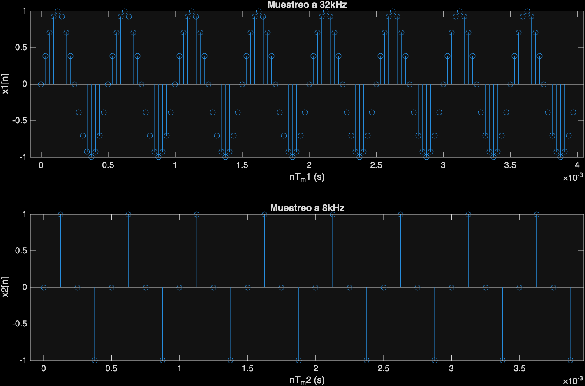

Obviamente la secuencia muestreada a 32kHz presenta un nivel de detalle mayor, de hecho 4 veces mayor que la secuencia muestreada a 8kHz. Esto se debe simplemente a que se han tomado muestras de manera más frecuente, por ejemplo a 32kHz se toman muestras cada $1/32\text{kHz}=31.25\mu s$, mientras que para 8kHz se toman muestras cada $1/8\text{kHz}=125\mu s$.

**P2**. Represente 6 ms de una sinusoide de 4 kHz muestreada a 16 kHz. Haga lo
mismo con 6 ms de una sinusoide de 12 kHz. ¿Qué sucede? ¿Qué se debe
hacer para evitar que haya confusión entre las dos secuencias?

```matlab
dur_s = 6e-3; % 6ms
F = 4e3; % 4kHz

F_m = 16e3; % 16kHz
T_m = 1/F_m;
t = 0:T_m:dur_s-T_m;
x1 = sin(2*pi*F*t);

F = 12e3; % 12kHz
x2 = sin(2*pi*F*t);

subplot(2, 1, 1); stem(t, x1); xlabel('nT_m (s)'); ylabel('x1[n]'); title('Sinusoide de 4kHz muestreada a 16kHz');
subplot(2, 1, 2); stem(t, x2); xlabel('nT_m (s)'); ylabel('x2[n]'); title('Sinusoide de 12kHz muestreada a 16kHz');
```

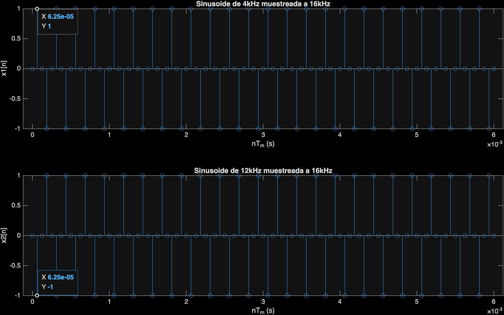

En la sinusoide de 12kHz muestreada a 16kHz ocurre aliasing debido a que no se cumple el criterio de Nyquist ($F_m>2F_a$), ya que en este caso $16\text{kHz}<2(12\text{kHz})$. Entonces diferentes frecuencias de la señal original pueden general las mismas muestras, de forma que ya no podemos distinguir entre dos señales diferentes a partir de sus muestras. Para resolver esta confusión se debe muestrear la sinusoide de 12kHz por encima de la frecuencia de Nyquist, i.e. se debe cumplir $F_m>24\text{kHz}$.

En este caso tenemos que: $x_1[n] = sin(2π\frac{4}{16}t)=sin(\frac{π}{2}t)$ y $x_2[n] = sin(2π\frac{3}{4}t)=sin(\frac{3π}{2}t)$. Entonces es evidente que $x_1[n]=-x_2[n]$.
Es decir occure aliasing, la sinusoide con frecuencia de $12\text{kHz}$ se puede confundir con una sinusoide de $4\text{kHz}$ de signo opuesto.

**P3**. Sea una sinusoide continua de frecuencia fa1 = 1.5 kHz que representaremos en un intervalo de 4 ms. Como MATLAB representa señales discretas, aproximaremos la señal continua muestreando a una frecuencia mucho mayor que la requerida, por ejemplo, 80 kHz. La señal discreta se obtendrá muestreando la sinusoide a fs = 8 kHz. Después del procesado (no haremos nada) emplearemos un ZOH (pulsos rectangulares) para la conversión D/C. Para suavizar la señal pasaremos la señal por un filtro de orden 4 y frecuencia de corte fc = 3 kHz. Todo esto se especifica de la siguiente forma: cd_dc(4e-3,80e3,1.5e3,0,8e3,'rectpuls',4,3e3); Compruebe a la salida hemos recuperado aproximadamente la señal ¿qué diferencias observa respecto a la señal inicial? Disminuya la frecuencia de corte del filtro a 1.5 kHz. ¿Qué ha cambiado en la señal reconstruida?

```matlab
dur_s = 4e-3; % 4ms
Fo = 80e3; % 80kHz
F_a1 = 1.5e3; % 4kHz
F_a2 = 0; % No tenemos una segunda sinusoide en este caso
fs = 8e3; % 8kHz
fc = 3e3; % 3kHz
N = 4;

% Conversión D/C mediante un ZOH
cd_dc(dur_s, Fo, F_a1, F_a2, fs, 'rectpuls', N, fc);
```

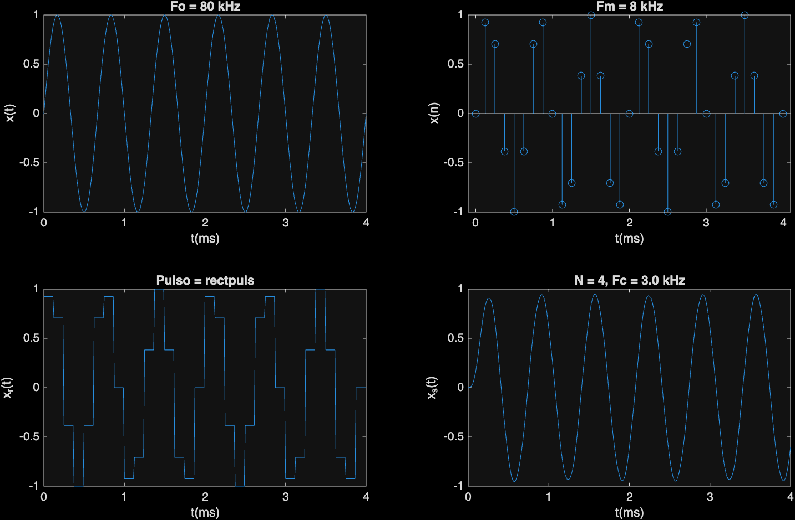

Respecto a la señal original $x(t)$ observamos que la amplitud se ha atenuado y varía ligeramente en cada periodo, i.e. presenta una leve distorsión y un retardo respecto a $x(t)$. Esto se debe a que el filtro reconstructor empleado no es ideal (tren de pulsos no ideales).

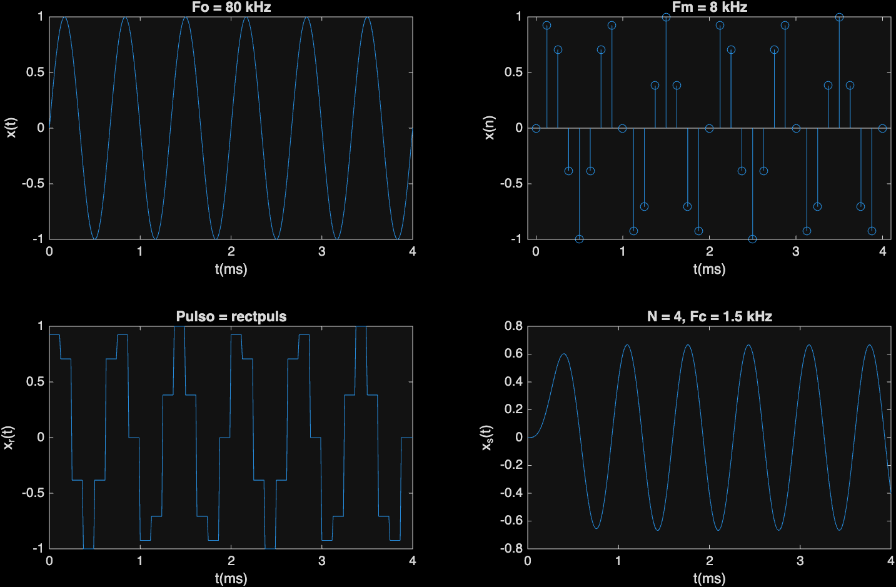

Al disminuir la frecuencia de corte a $f_c=1.5\text{kHz}$, la señal se ha atenuado y distorsionado aún más. Esto se debe a que la frecuencia de corte del filtro paso bajo (LPF) coincide ahora con la frecuencia de la señal original ($f_{a1}=1.5\text{kHz}$) y, por tanto esta componente también se ve atenuada de forma considerable. Entonces el filtro no preserva adecuadamente la componente frecuencial original, lo que causa una distorsión en la señal reconstruida.

**JUSTIFICACIÓN MÁS DETALLADA**:
Recordemos que el proceso de muestreo introduce réplicas en el espectro de la señal, centradas en los múltiplos de $f_s=8\text{kHz}$ , y el objetivo del LPF es eliminar estas réplicas para conservar únicamente las componentes frecuenciales originales (en este caso 1.5kHZ).
- Caso $f_c=3\text{kHz}$: la componente original en 1.5kHz se encuentra por debajo de la frecuencia de corte, por lo que el filtro conserva dicha componente relativamente bien. Pero ocurre una leve distorsión ya que el filtro no és ideal (respuesta frecuencial no plana?) y, además el ZOH tampoco és ideal (su respuesta frecuencial es una sinc, i.e. comete una cierta distorsión en la amplitud de la señal).
- Caso $f_c=1.5\text{kHz}$: la componente original en 1.5kHz se encuentra exactamente en la frecuencia de corte, que es el punto en el que ya se comete una atenuación considerable (normalmente de -3dB, cosa que cuadra ya que la amplitud se ve atenuada en ~30%). Consecuentemente, la componente original de 1.5kHz es atenuada de forma significativa y, por esta razón observamos la disminución de amplitud en la señal reconstruida.

**P4**. Ahora introduciremos la suma de dos sinusoides fa1 = 1.5 kHz y fa2 = 6.5 kHz, manteniendo fs = 8 kHz y un filtro de orden 4 con fc = 3 kHz. ¿Qué ha sucedido con la señal a la salida del convertidor D/A? Muestree las dos señales por separado para entender lo sucedido. ¿Qué cambios haría en el proceso de muestreo y reconstrucción para recuperar perfectamente la señal original? Muestre un resultado concreto.

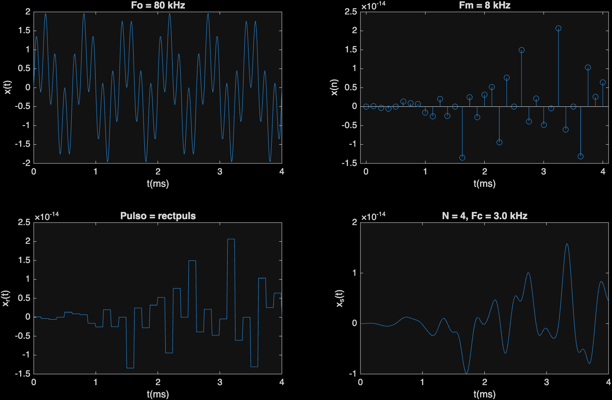

Observamos que durante el muestreo se pierde toda la información de la señal original (la escala vertical marca $\times10^{-14}$). Notemos que las dos sinusoides muestreadas a  $fs=8\text{kHz}$ se definen como: $$x_1[n] = sin(2π\frac{1.5}{8}), \space x_2[n]=sin(2π\frac{6.5}{8})$$. Pero podemos reescribir $x_2$ como: $$x_2[n]=sin(2πn-2π\frac{1.5}{8}n)=sin(-2π\frac{1.5}{8}n)=-x_1[n]$$. Esto implica que su suma es nula: $x_1[n]+x_2[n]=0$.
Entonces, muestrear ambas señales a 8kHz resulta en la misma señal, pero una de ellas con signo opuesto (aliasing). Esto se puede observar en el siguiente gráfico:

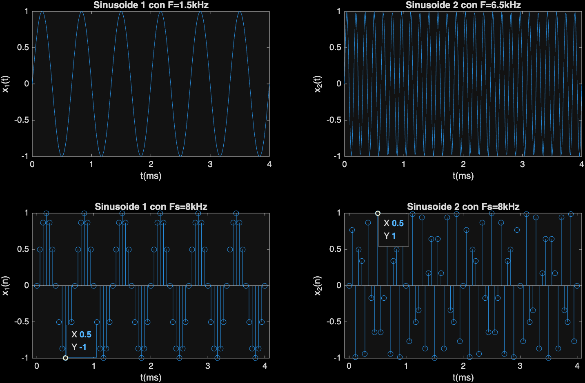

Para recuperar la señal correctamente debemos ajustar dos parámetros:
1. Frecuencia de muestreo ($f_s$): como que la componente frecuencial más alta es de 6.5kHz, $f_s=8\text{kHz}$ no cumple con el criterio de Nyquist. Es decir, necesitamos una frecuencia de muestreo que cumpla: $fs>2(6.5\text{kHz})=13\text{kHz}$. Por ejemplo podemos usar $f_s=18\text{kHz}$.
2. Frecuencia de corte ($f_c$): la frecuencia de corte de 1.5kHz no es suficiente para que el filtro conserve correctamente la componente en 6.5kHz. Por tanto hemos de incrementar la frecuencia de corte tal que quede por encima de 6.5kHz. Por ejemplo $f_c=9\text{kHz}$.

```matlab
dur_s = 4e-3; % 4ms
Fo = 80e3; % 80kHz
F_a1 = 1.5e3; % 4kHz (primera sinusoide)
F_a2 = 6.5e3; % 6.5kHz (segunda sinusoide)
fs = 18e3; % 18kHz
fc = 9e3; % 9kHz
N = 4;

% Conversión D/C mediante un ZOH
cd_dc(dur_s, Fo, F_a1, F_a2, fs, 'rectpuls', N, fc);
```
 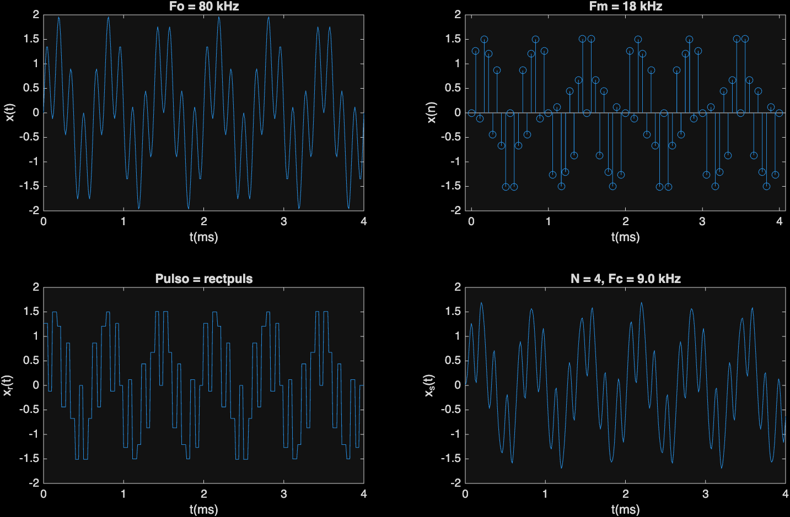

**P5**. Tome la señal muestreada a 8 kHz y, utilizando “:” de MATLAB, diézmela por factores 2, 4 y 8. Reproduzca las tres nuevas señales generadas con su nueva frecuencia de muestreo y analice su calidad. Visualice las nuevas señales en tiempo y en frecuencia. Explique el proceso de degradación que va sufriendo a medida que aumenta el diezmado usando el dominio temporal y frecuencial.

```matlab
F_m = 8e3;
audio = audiorecorder(F_m, 16, 1);
recordblocking(audio, 5);
x = audio.getaudiodata();

% Secuencias diezmadas
x_d2 = x(1:2:end);
x_d4 = x(1:4:end);
x_d8 = x(1:8:end);

% Reproducción de las secuencias diezmadas
sound(x_d2, F_m/2);
sound(x_d4, F_m/4);
sound(x_d8, F_m/8);

% Visualización en dom temporal y frecuencial
rep_tyf(x_d2); rep_tyf(x_d4); rep_tyf(x_d8);
```

La calidad de las señales generadas degrada directamente con el incremento del factor de diezmado. Esto se debe a que, al quedarnos con una de cada D muestras, la frecuencia de muestreo equivalente se reduce a $F_m/D$. Por ejemplo, realizar un diezmado con D=4 a una señal muestreada a 8kHz equivale a haberla muestreado a 8kHz/4=2kHz.

Desde el punto de vista temporal, se observa una pérdida progresiva de detalle en la representación de la señal ya que cada vez disponemos de menos muestras para representarla.

Desde el punto de vista frecuencial, la reducción de la frecuencia de muestreo implica una reducción en la frecuencia de Nyquist y, por tanto componentes frecuenciales que anteriormente podían representarse sin aliasing, posiblemente se solapen sobre otras componentes, provocando distorsión. Además, de las gráficas observamos que las posiciones de las componentes frecuenciales cambian a medida que baja la frecuencia de muestreo. 

**Diezmado por factor D=2**:
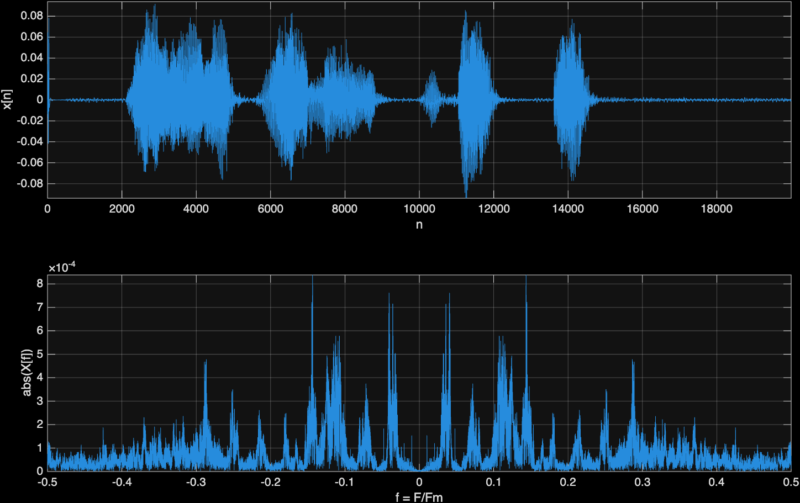

**Diezmado por factor D=4**:
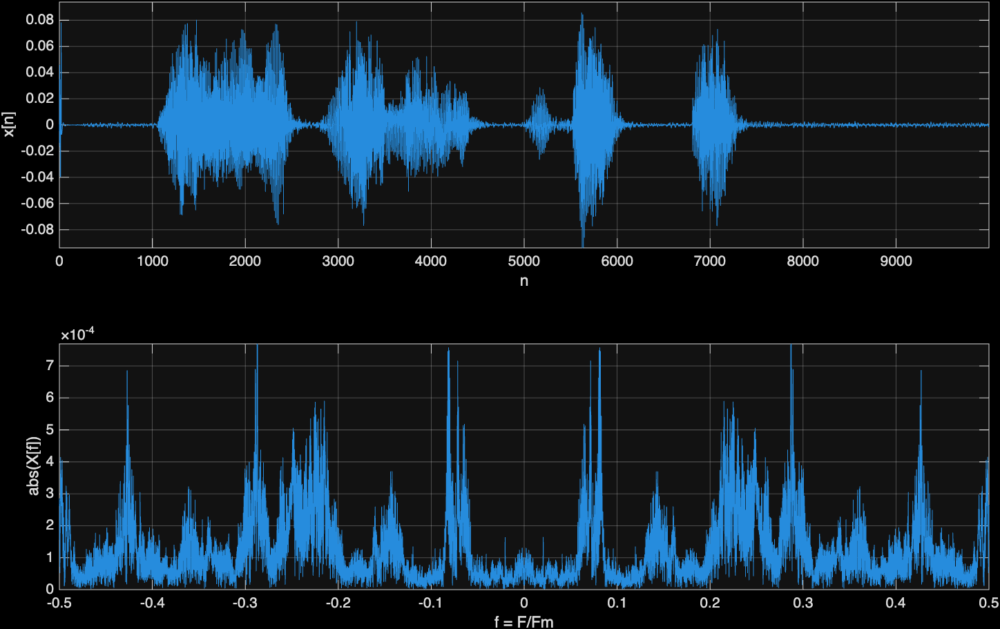

**Diezmado por factor D=8**:
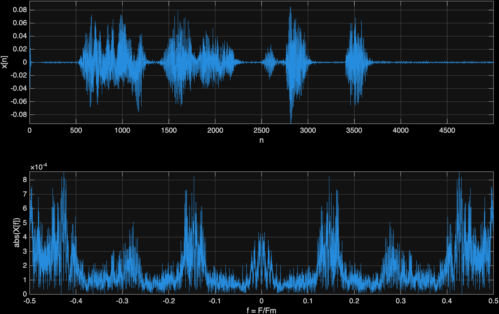

**P6**. Tome la señal muestreada a 8 kHz y, utilizando “:” de MATLAB y otros que considere convenientes, expándala por factores 2 y 4. Reproduzca las dos nuevas señales generadas y analice su calidad ¿Qué problema tienen? Visualice las nuevas señales en tiempo y en frecuencia y explique cuál es la causa del problema. Utilice el comando de MATLAB interp para hacer conjuntamente el proceso de expansión y filtrado. ¿Por qué no existe ahora ese problema? Represente las señales en el dominio de la frecuencia para explicarlo.

```matlab
% Suponiendo que x es el vector del audio muestreado a 8kHz del ej5
x_i2 = zeros(length(x)*2, 1);
x_i2(1:2:end) = x;
x_i4 = zeros(length(x)*4, 1);
x_i4(1:4:end) = x;

F_m = 8e3;
sound(x_i2, F_m*2);
sound(x_i4, F_m*4);

rep_tyf(x); rep_tyf(x_i2); rep_tyf(x_i4);
```

Hemos creado dos secuencias, en las que hemos intercalado ceros por factores $I=2$ e $I=4$. Al reproducir estas señales escuchamos un sonido "metálico" y un cierto "pitido" de fondo. Esto se debe a la aparición de réplicas de la componente frecuencial original a lo largo del espectro, y este fenómeno se ve reflejado en la representación de las señales donde observamos $I-1$ réplicas del espectro original. Por esta razón se debe aplicar un LPF tras la interpolación con el objetivo de eliminar estas réplicas que aparecen sobre la frecuencia de Nyquist original.

**Señal original sin modificar**:
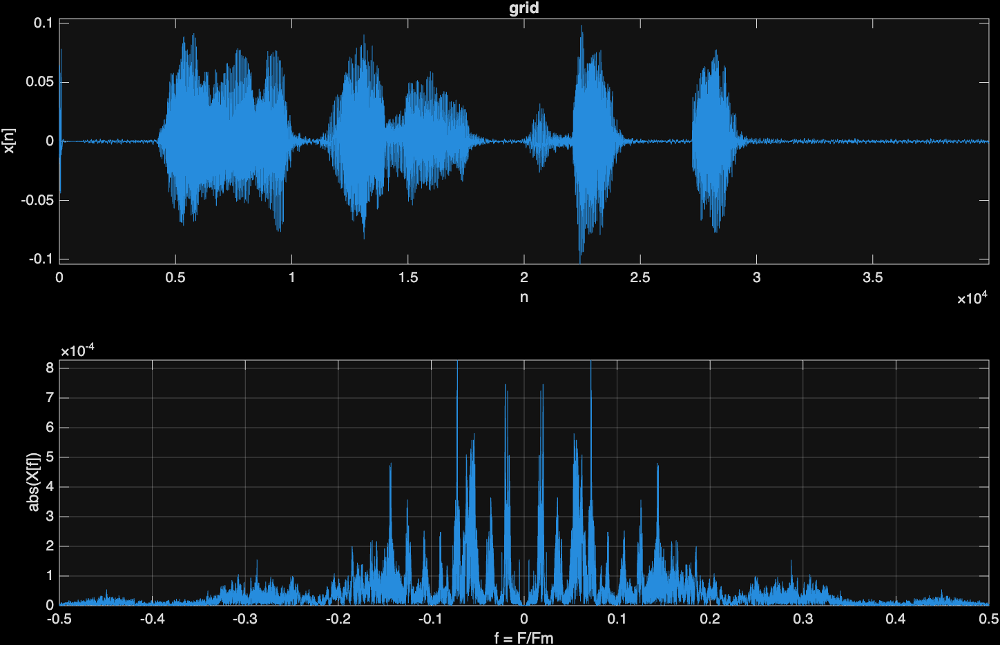

**Interpolación por factor I=2**:
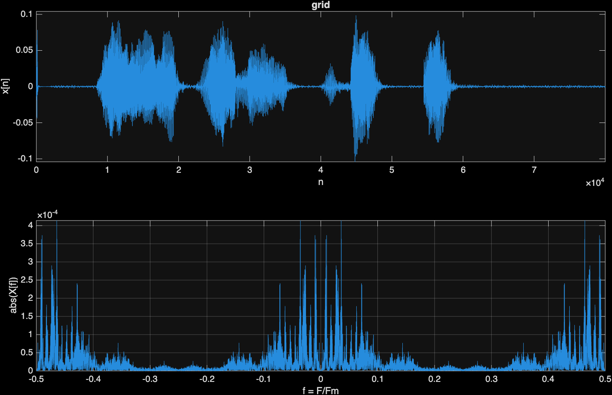

**Interpolación por factor I=4**:
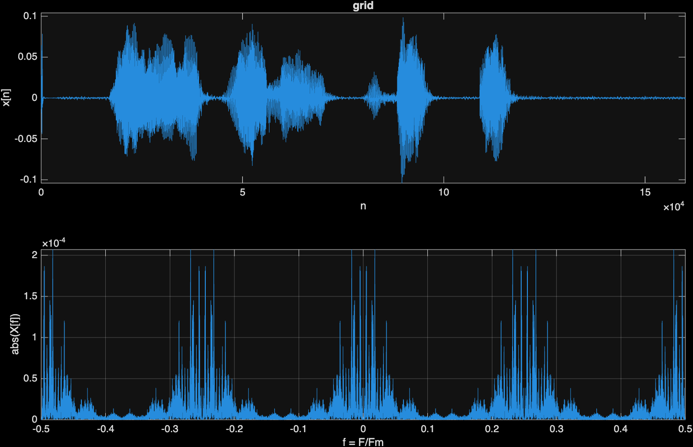

Si usamos el comando `interp`, observamos en la representación frecuencial de las señales que las réplicas se han prácticamente eliminado por completo. Esto se debe a que tras realizar el intercalado de ceros, aplica un filtrado (LPF) que atenúa de forma considerable las réplicas que occurren sobre la frecuencia de Nyquist.

```matlab
y_i2 = interp(x, 2);
y_i4 = interp(x, 4);
rep_tyf(y_i2); rep_tyf(y_i4);
```

**Interpolación por factor I=2 + LPF**:
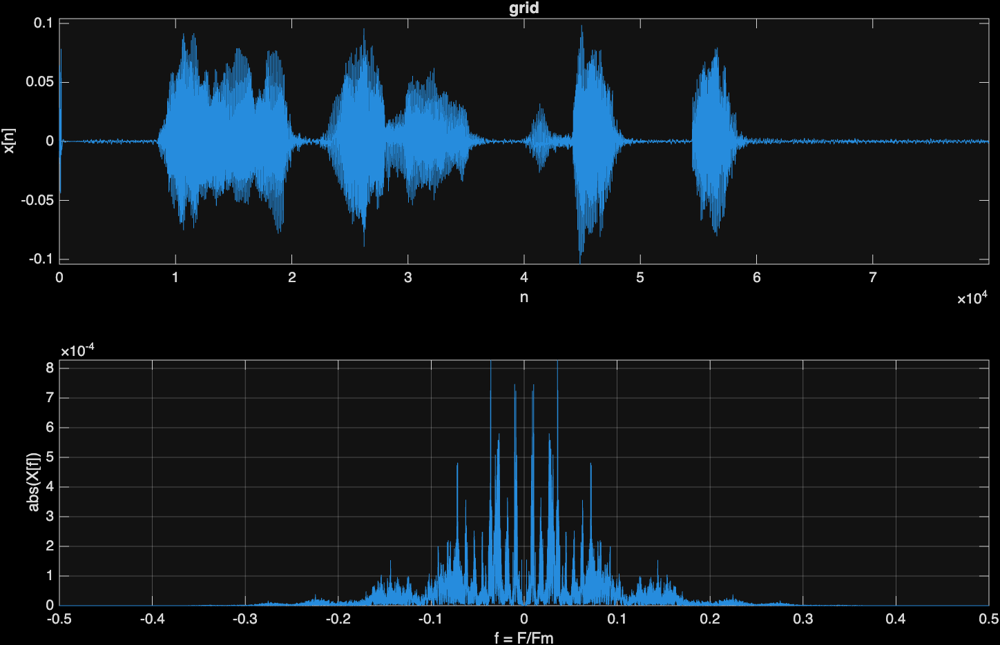

**Interpolación por factor I=4 + LPF**:


**P7**. A partir de la señal muestreada a 8 kHz, relacione los procesos de diezmado e interpolación con los de aceleración y ralentización de la voz. Represente las señales en los dominios temporal y frecuencial para comprobar que se ha conseguido el efecto y explique por qué las señales se oyen más agudas o graves.

El diezmado se puede relacionar con la aceleración de la voz si reproducimos la señal diezmada con la frecuencia de muestreo original en lugar de la equivalente, concretamente $F_m/D$, donde $D$ es el factor de diezmado. Esto ocurre porque la secuencia diezmada contiene menos muestras, por lo que la duración de la señal se ve reducida si la reproducimos con la frecuencia de muestreo original. Esto provoca la aceleración de la voz y un aumento de las frecuencias, haciendo que se escuche más aguda.
Matemáticamente, dada una secuencia de $N$ muestras y una frecuencia de muestreo $F_m$, la duración de la señal viene dada por $T=N/F_m$. Por tanto si aplicamos un diezmado por un factor $D$, la secuencia contiene $N/D$ muestras. Para preservar la duración original de la señal, habría que reproducirla a la frecuencia de muestreo equivalente de $F_m/D$. En caso contrario, si la reproducimos a $F_m$, la duración se reduce a $T/D$, acelerando la señal.

La siguiente gráfica representa diezmado por un factor $D=4$, donde observamos que la duración se ha reducido por el mismo factor y las frecuencias han aumentado:


La interpolación se puede relacionar con la ralentización de la voz si reproducimos la señal interpolada con la frecuencia de muestreo original. Esto ocurre porque la interpolación aumenta el número de muestras de la secuencia, i.e. la duración de la señal aumenta si la reproducimos a la $F_m$ original. Esto provoca la ralentización de la voz y una atenuación de las frecuencias, haciendo que se escuche más grave.
Matemáticamente, es el caso complementario al diezmado. La interpolación por un factor $I$ implica una secuencia de $I \times N$ muestras, por lo que solo es posible preservar la duración de la señal si la reproducimos a $F_m \times I$. En caso contrario, la duración aumenta a $T \times I$, ralentizando la señal.

La siguiente gráfica representa interpolación por un factor $I=4$ (incluyendo LPF), donde observamos que la duración ha aumentado por el mismo factor y las frecuencias se han disminuido:
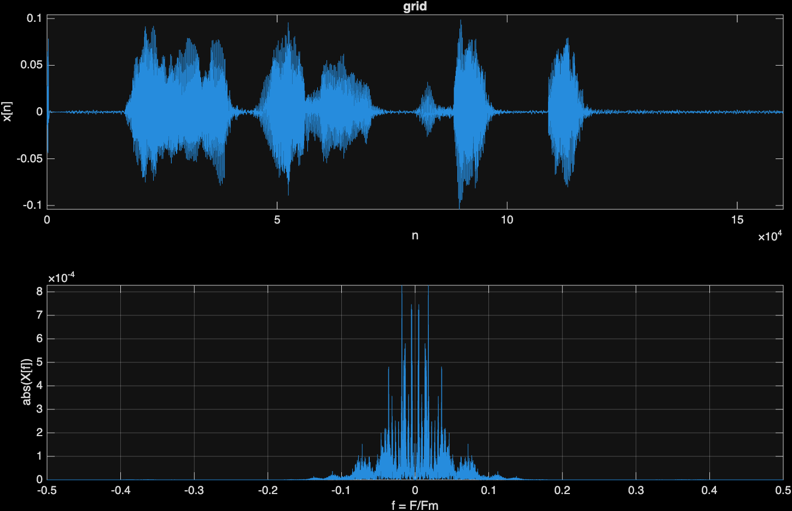

**P8**. Obtenga y represente en el dominio temporal una señal de voz acelerada (o
ralentizada) por un factor 2.5.

Realizar una ralentización por un factor $2.5$ equivale a realizar una interpolación por un factor de $5$ y un diezmado por un factor de $2$. Pues su frecuencia de muestreo equivalente sería de $F_m'=\frac{5}{2}F_m$, por lo que si reproducimos la señal de voz a la $F_m$ original, hemos aumentado su duración por un factor $2.5$ ($2.5T=2.5N/F_m$).

```matlab
x_id = interp(x, 5); % Interpolacion con I=5
x_id = x_id(1:2:end) % Diezmado con D=2
sound(x_id, F_m);
rep_tyf(x_id);
```

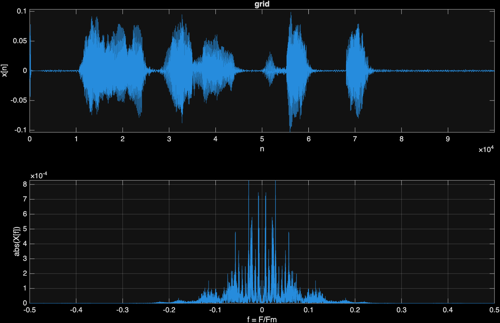

Alternativamente podríamos acelerar la voz por un factor $2.5$ intercambiando los factores ($I=2$, $D=5$). Pero este caso tiene riesgo de aliasing ya que esta nueva frecuencia de muestreo se ve reducida: $F_m'=\frac{2}{5}F_m=3.2\text{kHz}$, i.e. su frecuencia de Nyquist es de $1.6\text{kHz}$ y requiere filtrar las componentes por encima de $1.6\text{kHz}$ para evitar aliasing.